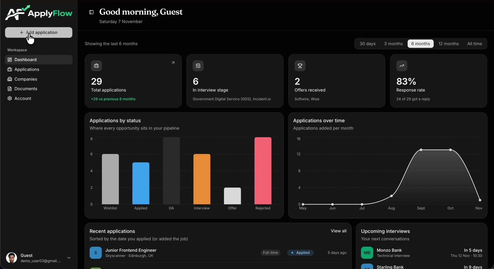
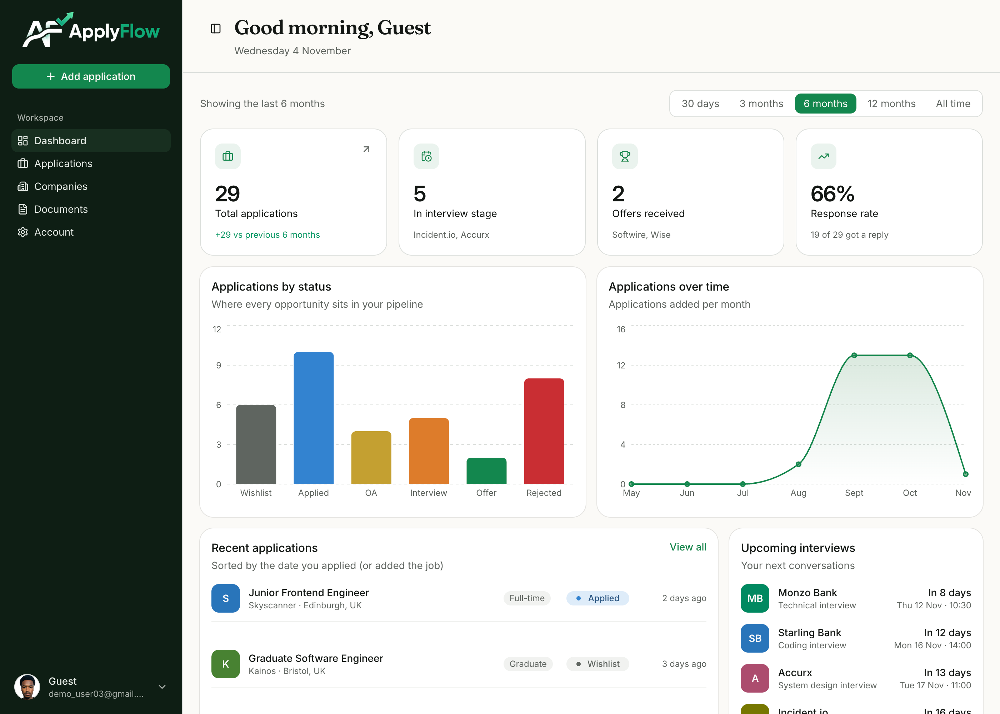
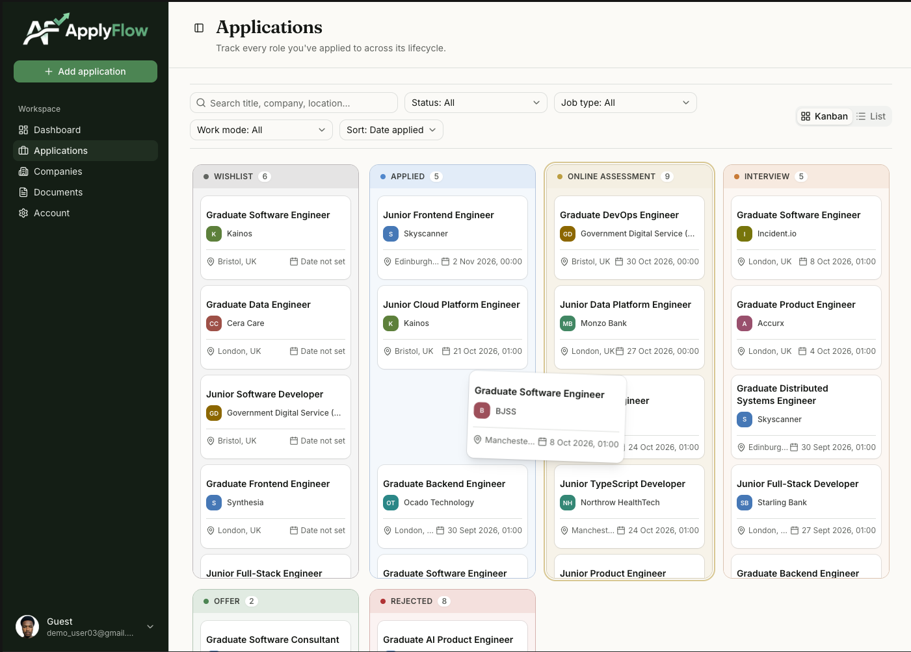
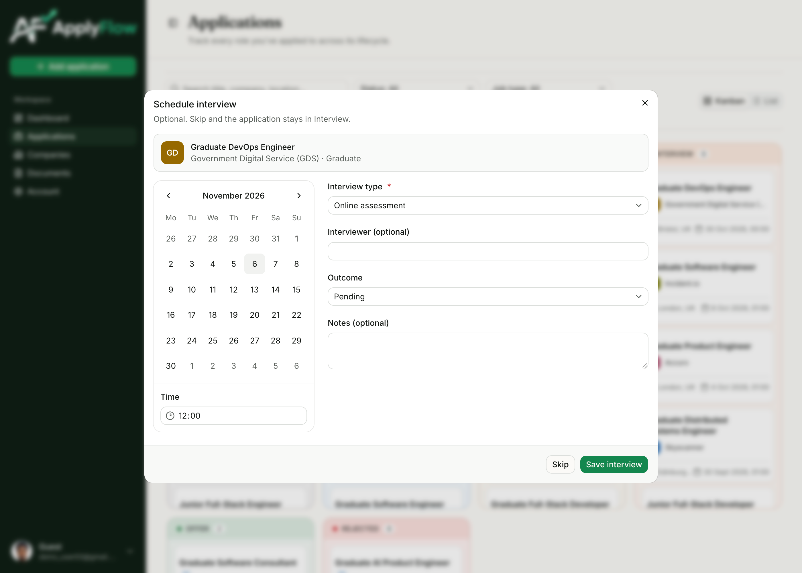
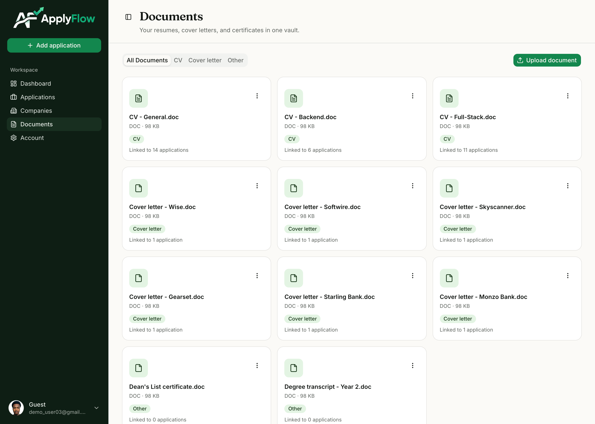

<p align="center">
  <picture>
    <source media="(prefers-color-scheme: dark)" srcset="./public/logo-light.png">
    
  </picture>
</p>

**ApplyFlow is a personal career command centre for your job search.** Track applications, companies, interviews and documents in one place, with a dashboard that shows what needs your attention.

[**Live demo**](https://applyflow-tracker.vercel.app) · [**Demo video**](./public/demo/demo.mp4)

[](./public/demo/demo.mp4)

**Try it:** create an account or sign in with Google. No setup needed.

## Features

- **Application Management:** Create and manage job applications with detailed information, including job title, company, salary, location, employment type, work mode, deadlines, notes and job links. Track progress through a drag-and-drop Kanban board or list view, with search, filtering and automatic status history.

- **Company Management:** Maintain reusable company profiles, associate multiple applications with each company, and search UK company records through the Companies House API. Prevent duplicate company records within your account.

- **Interview Management:** Schedule interviews against applications, record interview types, dates, times and interviewer details, and track outcomes (Pending, Passed or Failed). Keep track of upcoming interviews from your dashboard.

- **Document Management:** Upload and organise CVs and cover letters in a centralised document library. Link documents to applications, reuse them across multiple applications, and securely store and access files through AWS S3.

- **Dashboard & Analytics:** Monitor your job search through application statistics, status and source breakdowns, application trends over time, recent activity, applications awaiting replies and upcoming interviews.

- **Authentication & Account Management:** Register and sign in using email/password or Google OAuth. Manage profile information and profile pictures, with user-specific data, responsive layouts and system-aware light and dark themes.

## Screenshots

**Dashboard**

<picture>

  <source media="(prefers-color-scheme: dark)" srcset="./public/dashboard_images/dashboard-dark.png">
  
</picture>

**Kanban board**

<picture>
  <source media="(prefers-color-scheme: dark)" srcset="./public/application_images/applications-kanban-dark.png">
  
</picture>

**Interviews**

<picture>
  <source media="(prefers-color-scheme: dark)" srcset="./public/interview_images/interviews-dark.png">
  
</picture>

**Documents**

<picture>
  <source media="(prefers-color-scheme: dark)" srcset="./public/document_images/documents-dark.png">
  
</picture>

## Tech stack

| Area           | Technology                                                                                  |
| :------------- | :------------------------------------------------------------------------------------------ |
| Frontend       | Next.js 16 (App Router), React 19, TypeScript, Tailwind CSS v4, shadcn/ui                   |
| UI libraries   | Recharts, TanStack Table, dnd-kit, Motion, Lucide React, next-themes                        |
| Backend        | Next.js Server Actions, Better Auth (email/password and Google OAuth), Zod, React Hook Form |
| Database       | PostgreSQL on Neon, Drizzle ORM                                                             |
| Storage        | Amazon S3 (private bucket, presigned URLs)                                                  |
| Infrastructure | Vercel, with Vercel OIDC federation to AWS IAM (no long-lived AWS keys)                     |
| External API   | Companies House                                                                             |

## Technical highlights

- **Per-user data isolation:** every query is scoped to the signed-in user, and client-supplied ids and file keys are ownership-checked on the server.
- **Direct-to-S3 uploads:** files go from the browser to a private bucket using short-lived presigned URLs, so they never pass through the app server.
- **Cached, per-user data:** reads use Next.js caching with tags, and mutations invalidate only what changed.
- **Theme-aware images:** light and dark variants are switched with CSS, so there's no flash on load.

## Running locally

**Requirements:** Node.js 20+, a PostgreSQL database (Neon works), an S3 bucket, and Google OAuth credentials.

```bash
git clone https://github.com/A-Karim2003/ApplyFlow.git
cd ApplyFlow
npm install
```

Create a `.env` file in the project root:

```bash
DATABASE_URL=            # PostgreSQL connection string
BETTER_AUTH_SECRET=      # long random string
BETTER_AUTH_URL=http://localhost:3000
GOOGLE_CLIENT_ID=
GOOGLE_CLIENT_SECRET=
```

S3 and Companies House settings are also required for uploads and company search.

```bash
npx drizzle-kit migrate
npm run dev
```

Open [http://localhost:3000](http://localhost:3000).

For Google sign-in, add `http://localhost:3000/api/auth/callback/google` as an authorised redirect URI in your Google Cloud OAuth client. For browser uploads, the S3 bucket's CORS configuration must allow `PUT` from `http://localhost:3000`.

## Post-MVP

The MVP is feature-complete. Planned next:

**AI features**

- **Ask your data:** ask questions in plain English about your own applications, interviews, companies and documents, and get answers grounded only in your data.
- **Application autofill:** paste a job posting and have the application form filled in automatically.
- **Eligibility check:** compare a job's requirements against your CV and get a quick view of how well you match.

**Capture**

- **Browser extension:** save a job to ApplyFlow directly from the page you're viewing, without copying details by hand.

**Engineering**

- Automated tests for server actions, starting with cross-user ownership checks.
- CI with GitHub Actions: lint, type check and tests on every push.
- Atomic multi-file uploads and S3 cleanup for orphaned files.
